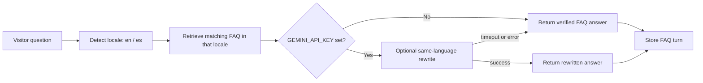

# Multilingual FAQ Bot

A small Harbor Desk support assistant that detects English or Spanish questions, retrieves an answer from a locale-specific FAQ, and can optionally rewrite that verified answer with Gemini. Retrieval always works without an API key.

## How the AI works



The locale and FAQ lookup are deterministic. `App\Services\Llm\LlmClient` isolates the optional rewrite; the Gemini implementation has a 12-second request timeout and falls back to the original FAQ answer on errors. The database stores each question, answer, detected locale, and matched FAQ slug.

## Run locally (no API key required)

Requirements: PHP 8.3+, Composer, and Node.js 22+.

```bash
composer install
copy .env.example .env
php artisan key:generate
php artisan migrate --seed
npm install
npm run dev
```

Open <http://localhost:8000> in a second terminal after starting the app with `php artisan serve`. Seed data contains four fictional Harbor Desk FAQs in English and Spanish; it uses no real customer information. No sign-in is required. The app uses SQLite and does not require Redis or an LLM key.

To enable optional Gemini rewrites, set `GEMINI_API_KEY` in `.env` and restart the app. Without it, `FakeLlmClient` returns the verified retrieved answer unchanged.

## Tests

```bash
composer test
```

The Pest feature tests verify that a Spanish shipping question retrieves the Spanish shipping entry and stores `locale=es`, an English support-hours question retrieves the English entry, the no-key container binding uses `FakeLlmClient`, and a guest can submit a question successfully. Tests use an in-memory SQLite database and never call Gemini.

## Stack

- Laravel 13 · PHP 8.3+
- Vue 3 · Inertia · Tailwind CSS
- SQLite · Pest
- Optional Gemini API via Laravel's HTTP client
